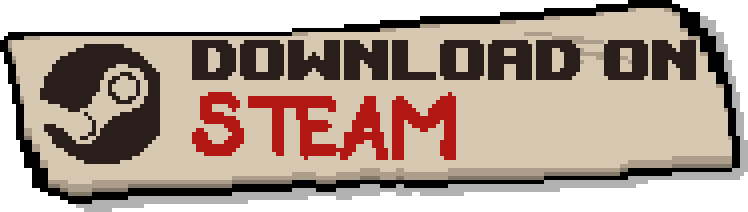
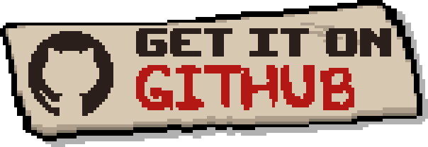
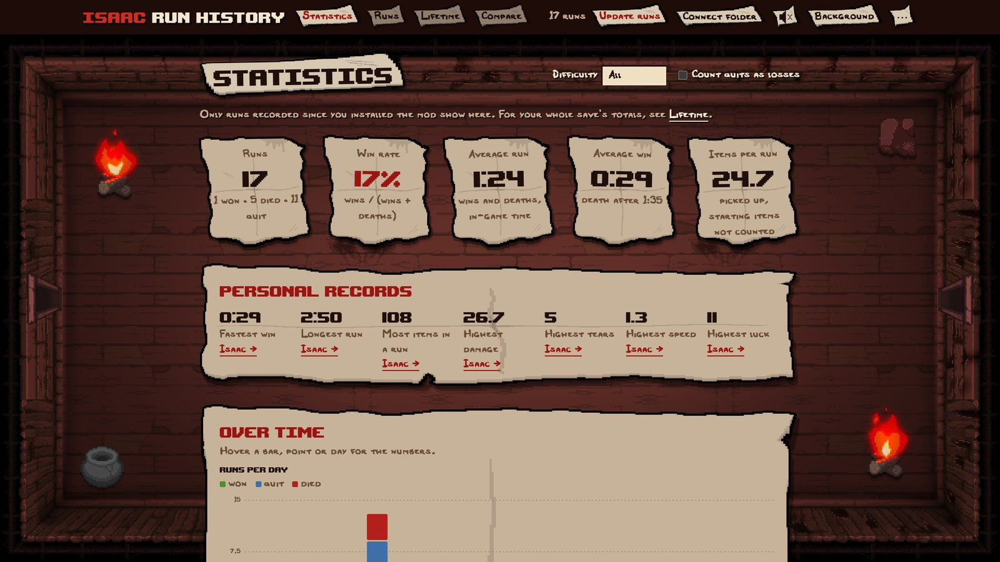
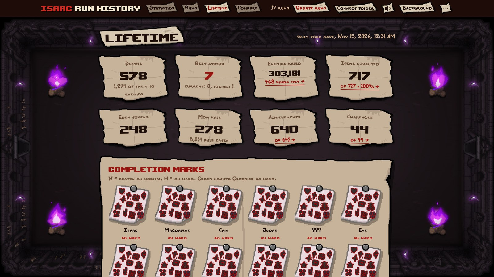
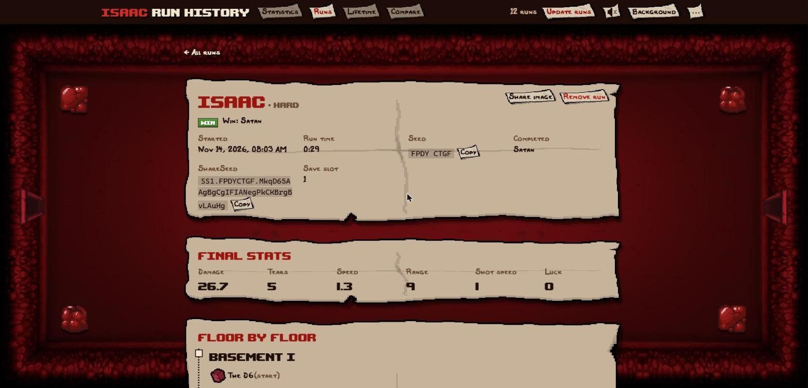
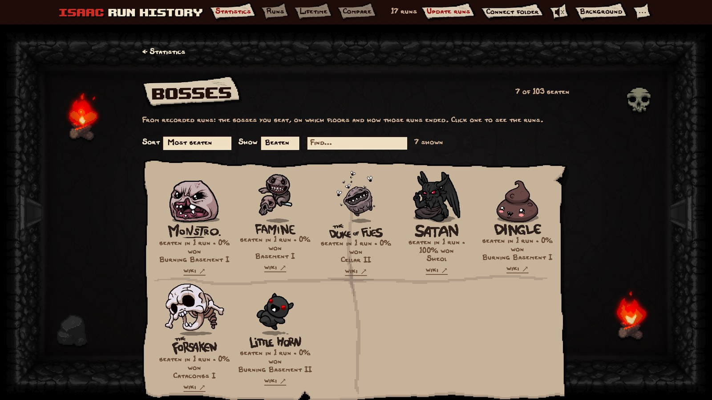
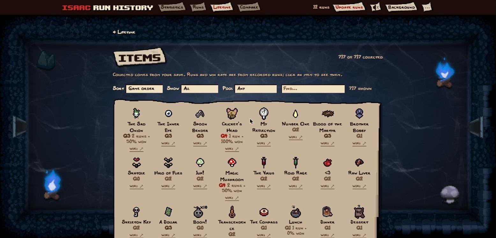
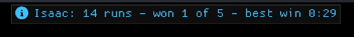
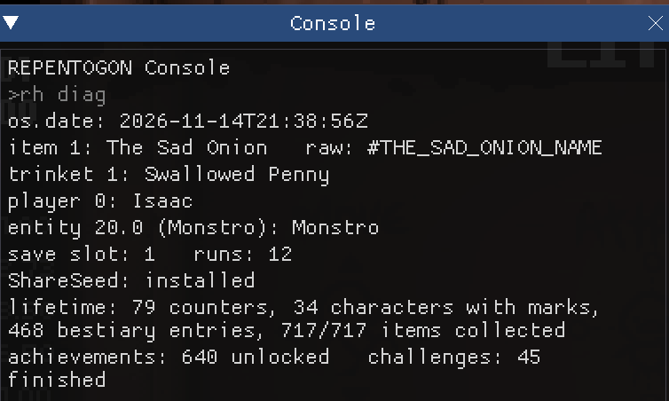

# Isaac Run History

How many runs have you actually won as Azazel? What kills you the most? Is Brimstone really that
good, or do you just remember it because those runs were fun?

Isaac Run History records every run (wins, deaths and restarts), and a web page turns them into
statistics.

For Repentance+ with [REPENTOGON](https://repentogon.com).

<p>
  <a href="https://steamcommunity.com/sharedfiles/filedetails/?id=3841181539"></a>
  <a href="https://github.com/tomandesMSH/isaac-run-history/releases/latest"></a>
</p>

The project has two parts:

- **The mod** (`mod/isaac-run-history`) saves a record of every run to your history.
- **The web page** (`web/`) takes the export and shows statistics. It runs only in your browser,
  your data goes nowhere.

## Screenshots

**The web page**, at [tomandes.eu/isaac-run-history](https://tomandes.eu/isaac-run-history/). The room
in the background is your pick of the game's floors.



| | |
| --- | --- |
|  |  |
| **Lifetime:** the save's totals and completion marks drawn like the pause menu's | **A run:** result, seed, final stats, floor by floor |
|  |  |
| **Bosses:** the versus screen's portraits, where and how often you beat them | **Items:** the whole collection, quality, pools, how runs with them went |

**In the game:** your record with the character when a run starts, and `rh diag` in the console.





## What gets saved for each run

- date and time, run length (in-game time, the same as the game's own timer)
- seed, character, difficulty (normal / hard / greed / greedier), challenge
- result: **win** (which ending), **death** (what killed you and on which floor), **quit**
  (restart, or left without saving)
- items in the order you picked them up, with the floor and room type; items you lost later
  (rerolled, swapped out) are marked
- trinkets (golden and smelted too), bosses beaten per floor, floors played including the alt path
- final stats: damage, tears, speed, range, shot speed, luck
- the [ShareSeed](https://github.com/tomandesMSH/ShareSeed) code, if you have it installed

Every export also carries **lifetime totals from the game's own save** (`persistentgamedata`),
covering every run you ever played, from before the mod too: completion marks per character, the
bestiary (what killed you how often, what you killed most), your item collection and what's still
missing, the unlocked achievements (mod 1.2+), the finished challenges (mod 1.3+) and the game's
counters (deaths, final bosses beaten, best streak, Eden tokens, pills eaten, ...). The save keeps
totals only, no list of runs, so per-run stats still come from the mod.

## Installing

1. Install [REPENTOGON](https://repentogon.com).
2. Subscribe on the [Steam Workshop](https://steamcommunity.com/sharedfiles/filedetails/?id=3841181539),
   or download the zip from [Releases](https://github.com/tomandesMSH/isaac-run-history/releases/latest)
   and unpack it into `...\The Binding of Isaac Rebirth\mods\` (you get `mods\isaac-run-history\`).

## Using it

Open the console and click **Run History -> Last runs / export** in the menu bar, or use the commands:

| Command                  | What it does                                                    |
| ------------------------ | --------------------------------------------------------------- |
| `runhistory` / `rh`      | Your last 10 runs                                               |
| `rh info N`              | Run #N: items floor by floor, stats, seed                       |
| `rh export`              | Copy the whole history (JSON) to the clipboard                  |
| `rh path`                | Where the history file is                                       |
| `rh web`                 | The statistics page's link (copied to the clipboard)            |
| `rh notif 0` / `1`       | Turn the popups at the start of a run off / on                  |
| `rh diag`                | Check what your game / REPENTOGON version provides (for bug reports) |

## Where the data is and how to get it to the web page

The history is saved in `<Isaac folder>\data\isaac-run-history\saveN.dat` (N = save slot).
That file **is the export**: JSON you can drag onto the web page. Or run `rh export` and paste
the clipboard.

The format is described in [`schema/run-history.schema.json`](schema/run-history.schema.json).

## The web page

Drag `save1.dat` (or a pasted `rh export`) onto the page. Runs are kept in the browser
(IndexedDB) and merged by run id, so importing the same file again only adds the new runs; files
from different save slots add up.

- **Statistics:** win rate per character, personal records, runs over time, endings, most picked
  items and trinkets, the ones with the best win rate (with a minimum number of runs, so one lucky
  run doesn't top the list), winning item pairs, where items come from (treasure, shop, devil...),
  devil vs. angel deals, item quality by floor, alt path and curses, bosses beaten, causes and
  floor of death. Filter by difficulty; quits can count as losses.
- **Runs:** every run, filtered by character, result, difficulty, boss, challenge or item / trinket
  (`Brimstone + Tammy's Head` finds runs with both).
- **Run detail:** floor-by-floor timeline of items, trinkets and bosses, final stats, seed,
  ShareSeed code and a share image.
- **Characters:** one page per character with their runs, records, items and completion marks.
- **Bosses:** every boss with the versus screen portrait: how often you beat it, where, and how
  often it killed you.
- **Lifetime:** the totals from the game's save: completion marks drawn like the pause menu's,
  counters, and pages for the **bestiary**, the **item collection**, **achievements** and
  **challenges** (rules, unlocks, finished or not).
- **Compare:** add a friend's `save1.dat` and see your numbers side by side. Their runs are kept
  apart and never count in your statistics.

In Chrome or Edge you can **connect the history folder** once (top bar): the page then reads the
newest runs by itself on every visit and whenever you switch back to its tab. (Brave has this off
by default: `brave://flags/#file-system-access-api`.)

Win rate is wins / (wins + deaths): restarts and runs cut short by a crash aren't counted unless
"Count quits as losses" is on.

### Building and deploying

```
cd web
npm install
npm run dev      # http://localhost:5173
npm run build    # static site in web/dist
npm test         # statistics and export parsing (Node's test runner, bundled by Vite)
```

The page is live at **https://tomandes.eu/isaac-run-history/**: every push to `main`
builds it and publishes it on GitHub Pages (`.github/workflows/pages.yml`). It's a static site with
relative paths, so the contents of `web/dist` also work from any other host or subfolder.

### Game graphics

The room, paper, fonts, item icons, bestiary drawings, boss portraits and achievement pictures in
`web/public/gfx/` (and the lists in `web/src/data/`) come from the game. They were taken
from the game's unpacked resources with `tools/extract_assets.py` (which also turns the game's
bitmap fonts into TrueType); run it again only to refresh them after a game update:

```
pip install pillow fonttools
python tools/extract_assets.py
```

### Music

The page can play the music of the floor it's set in (speaker icon in the top bar; the volume
always starts at 0), from the Repentance+ or the Antibirth soundtrack. The music isn't part of this
repo: it lives in [Isaac-run-history.musicDb](https://github.com/tomandesMSH/Isaac-run-history.musicDb)
(`rep/` and `antibirth/`) and the page streams it from GitHub, pinned to one commit of that repo.
After changing the music repo, run `python tools/music_manifest.py` to point the page at the new
commit and commit `web/src/data/music-manifest.json`.

## Limitations

- **Each save slot has its own history.** The web page can merge them.
- **Deleting the `data` folder or uninstalling the mod deletes the history.** Export it now and then.
- **The cause of death is a best guess.** The game doesn't tell mods what killed the player, so
  the last thing that hurt you is saved (for shots and bombs, whoever fired them). A death with
  no source (spikes, IV Bag, the Curse Room door) is saved as "no source".
- **Restarts shorter than 2 seconds** with no item picked up aren't saved (resetting for a good
  start, restarts by other mods).
- **Crashes:** the run in progress is saved on every floor and after every boss. If the game
  crashes and you start a new run, the previous one is saved with an "unknown" ending.
- Co-op isn't handled; only the first player is recorded.

## Target version

Repentance+ v1.9.7.12 + REPENTOGON 1.1.3 (not tested in game yet).
